# 作品集展示 Portfolio

个人项目与实习期间参与项目的展示仓库：**源码均存放在私有仓库**（含公司内部代码，不公开），此处只展示项目介绍与脱敏后的效果图/设计产出。

---

## 一、智融析 · 金融智能研报分析与投资决策辅助系统

> 源码仓库（私有）：`zhirongxi`

面向金融研报场景的 AI 全栈应用系统：研报上传解析、智能问答、一键研报生成与合规审核，覆盖数据采集到报告产出完整闭环。技术栈：FastAPI + React 18 + MySQL + Redis + Neo4j + ChromaDB + LangGraph + Ollama + Docker Compose。

### 系统截图


**01_登录页**：登录页：RAG 智能解读 / ML 量化分析 / 合规自动审核三大能力 + 三角色 RBAC 差异化菜单


**02_文档解析分块**：财报 PDF 解析为语义分块（bge-large-zh 嵌入，含 tokens 与原文溯源）


**03_关联图谱**：Neo4j 知识图谱：公司-行业-概念关系可视化（归属/关联/同行业）


**04_监控告警与链路追踪**：告警面板（RAG 延迟/LLM 错误率/合规违规）+ LangSmith 全链路 Trace


**05_系统首页仪表盘**：首页：知识库文档/解读查询/分析任务/风险预警 + 使用趋势 + 任务分布


**06_系统监控与架构**：四引擎架构：RAG(LlamaIndex+Chroma)/ML(sklearn+NumPy)/LLM(Qwen2.5+Ollama)/Agent(LangGraph)


**07_评估指标看板**：16 项质量指标：问答准确率 82.3%、幻觉率 0%、来源覆盖 100%、工具调用成功率 85.3%


**08_研报解读问答**：智能问答：核心回答+详细分析+风险提示，置信度自评估并触发补充检索


**09_综合分析ML量化**：ML 量化分析：趋势预测 R²、风险分级、聚类分群 + AI 五维专业解读


**10_研报生成**：LangGraph 四角色流水线自动生成结构化研报（投资要点/公司概况/行业分析/财务分析）


**11_财务分析**：财务与估值：ROE/PE/PB/EPS 解读 + 三表解读 + 估值分析 + 风险提示

---

## 二、硅流 · AI 辅助硬件设计多智能体平台

> 源码仓库（私有）：`silicon-flow`
> 实习期间参与的公司内部项目，应保密要求不公开源码；以下截图为脱敏后的产品界面，账号信息已隐去。

一句话需求 → 6 个 Agent 串行协作（规格解析 → 器件选型 → 原理图生成 → PCB 布局 → 多模态校准 → 产物生成），产出可直接使用的 EDA 工程包：KiCad 工程、BOM、钻孔与 Gerber 打样包、方案文档与主控源码。

技术栈：FastAPI + Vue 3 + SQLite（字段兼容 MySQL 便于迁移）+ Milvus / 本地 JSON 双通道向量库 + bge-large-zh 向量召回 + BM25 + bge-reranker-v2-m3 精排 + Ollama（qwen2.5 / minicpm-v4.6）+ Docker。

### 平台界面

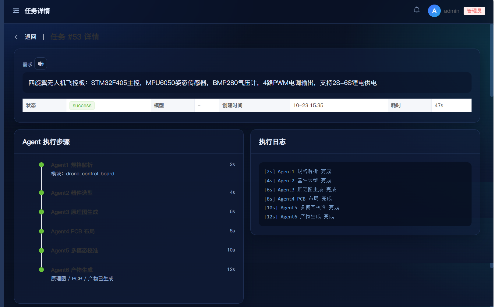

**01 多智能体流水线**：输入一句自然语言需求（四旋翼无人机飞控板：STM32F405 + MPU6050 + BMP280，4 路 PWM 电调，2S–6S 供电），6 个 Agent 依次执行并实时回显日志，单任务全程 47s。

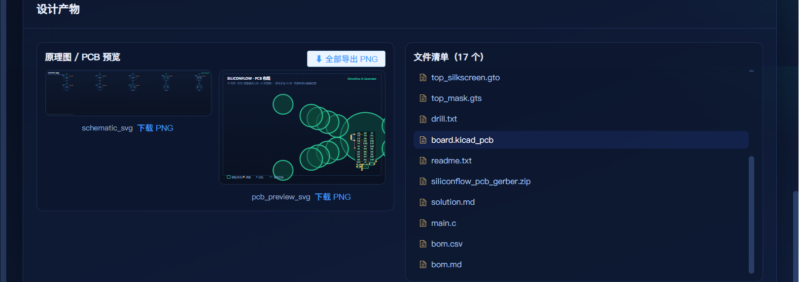

**02 设计产物落盘**：单次任务输出 17 个文件——KiCad 工程（`board.kicad_pcb`）、Gerber 打包（`siliconflow_pcb_gerber.zip`）、钻孔文件、BOM（csv + md）、主控源码与方案文档，前端可直接下载。

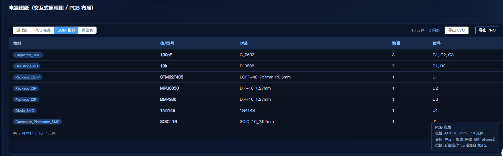

**03 BOM 物料表**：器件型号全部来自库内真实元件（STM32F405 / MPU6050 / BMP280），带封装与位号，可直接核对采购清单——这也是用 RAG 检索替代模型「记忆」型号的原因。

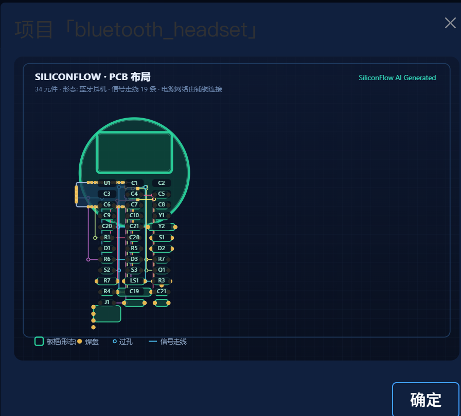

**04 PCB 布局参考**：按板框功能区自动分区布线（图为蓝牙耳机形态：34 元件、19 条信号走线、电源网络铺铜连接）。


**05 形态库 · 异形板**：把真实产品外形建模成板框几何约束——四旋翼 X 形四臂 160×160（11 个功能区）、智能温控风扇等。通用布局只会产出矩形板，形态库解决的是「生成的板能不能装进产品」。


**06 纠错型知识库**：历史失败案例（复位遗漏、位宽不匹配、阻塞赋值混用等）入库，召回后经 bge-reranker 精排再回灌给 Agent——这套 RAG 用于纠错，不是问答。

### 设计产出（可编辑 KiCad 工程）

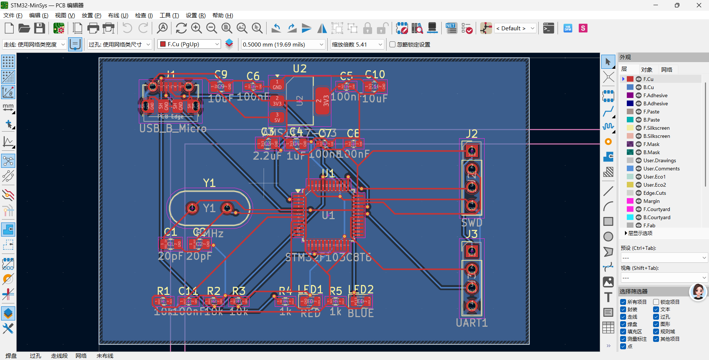

**07 KiCad PCB 编辑器**：产物是原生可编辑的 KiCad 工程，而不是一张渲染图，可继续人工修改与打样。

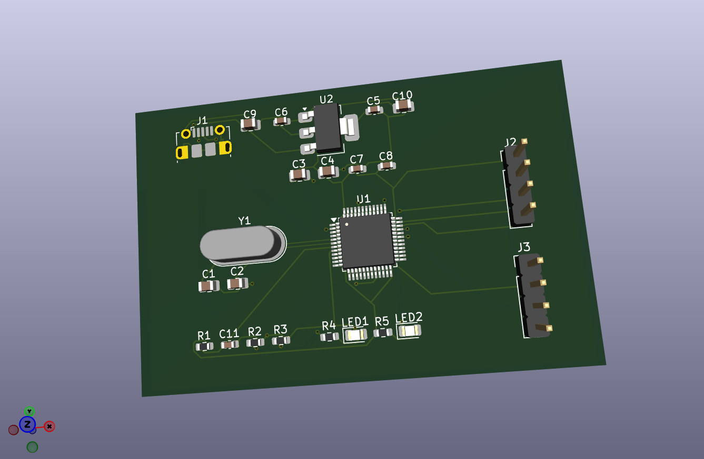

**08 PCB 3D 渲染**：STM32 最小系统板（STM32F103C8T6）3D 视图。

---

## 三、闭环验证 · 四旋翼 X 形飞控板：从 AI 生成图到可下单 Gerber

> 这一节回答一个问题：**硅流生成的那个 `board.kicad_pcb`，到底能不能拿去打样。**
> 结论是「不能」，但它是一块能修到「能」的料——下面每一步都有可复跑的判分依据，不是渲染图好看就算过。

### 结论先行

| 项 | 硅流生成（v1） | 重建定稿（v3） |
|---|---|---|
| 能否打开 | 打不开：文件头是 KiCad 5、正文是 v7 语法，混写 | 能，KiCad 10.0.6 正常加载 |
| DRC | **428 条违规 / 13 处未连接** | **0 条违规 / 0 处未连接** |
| 板框 | 21 个独立圆，拼不成一条闭合轮廓 | X 形四臂 136.2 × 136.2 mm，闭合 |
| 封装 | 39 个 `module Custom` 手搓假焊盘 | KiCad 官方库真封装，43 元件 |
| 网络 | 64 个网，51 个孤儿网 | 24 个网，0 孤儿网 |
| 打样包 | 8 KB zip，Gerber 缺层 | 10 个文件，双层完整，463 KB |

一句话：**文件能打开，图能看，结论不能用。** 换真封装、按真实机架重算板框、重新布线之后，才算走完闭环。

### 六步是怎么跑通的


**第 1 步 · 生成**：一句话需求进硅流，6 个 Agent 串行跑完 47 秒，落盘 17 个文件，其中就有 `board.kicad_pcb`。

**第 2 步 · 打不开**：KiCad 直接报错退出。逐处排查发现是语法混写——板级孤立 `fp_text`、35 处 `(model (xyz))` 缺参数、`(justify center)` 位置非法、`visible_elements` 多参数、`design_rules` 段落误入，共 5 类。修完这 5 类才加载成功。

**第 3 步 · 真 DRC 判分**：不看图，只看报告。

```bash
kicad-cli pcb drc --format json -o drc.json board_fixed.kicad_pcb
# 428 violations / 13 unconnected items
```

**第 4 步 · 诊断三处病灶**（这一步决定「调参」还是「重建」）：

- 板框是 21 个各自独立的圆，不是一条闭合轮廓——PCB 厂第一眼就退；
- 39 个封装是 `module Custom` 手搓的，焊盘尺寸和真实器件对不上；
- 64 个网络里 51 个是孤儿网（只有一端），说明连线是「画上去的线」而不是「连起来的网」。

结论：这三个问题都不是参数能救的，必须按真实器件与真实机架重建。

**第 5 步 · 按真实产品重建**：以硅流输出的 13 个真实网络为电气骨架（**没有抄任何开源工程**），补上它漏掉的电源与外围——3V3 网络有、但没有 3.3V 来源，补 AMS1117-3.3；BOOT0 悬空，补下拉；蜂鸣器直连 IO，补 S8050 与基极电阻；PA0–PA3 接 TIM2_CH1–CH4 驱动四路电调。板框按四轴真实机架重算：中心 60×60 放全部飞控电路（与飞控塔装尺寸一致），四条 18 mm 宽对角臂只承担电机座与电调焊盘——每个臂端 4×M2 孔 + 1×3 电调焊盘（SIG/5V/GND）。

**第 6 步 · 布线到可下单**：

```bash
# 1. 导出 Specctra DSN，交给 FreeRouting 自动布线
# 2. FreeRouting 2.4.1 跑完导出 SES（score 999.99，127 条未布网络 → 0）
# 3. 回灌 SES，双面 GND 铺铜 + 热焊盘
kicad-cli pcb drc --format json -o x_drc7.json xframe_routed.kicad_pcb
# 0 violations / 0 unconnected items
```

### 判分证据

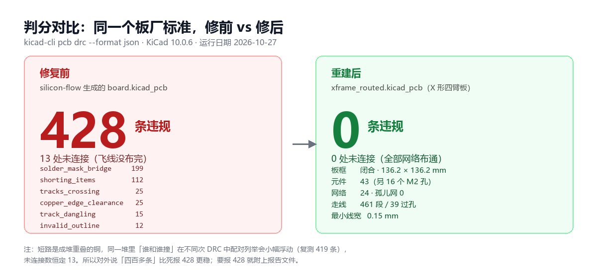

两个数字必须一起说：**修复前 428 条违规、13 处未连接；修复后 0 条、0 处。**

两点口径说明，都是自己先交代的：

1. **428 是 2026-10-27 16:04 那份报告的原始数字。** 短路是成堆重叠的铜，「谁和谁撞」的配对列举在不同次 DRC 中会小幅浮动（复测 419 条），未连接数恒定 13。所以对外更稳的说法是「四百多条」，要报精确数就附报告文件。
2. **0 违规不是靠放宽规则换来的。** 最小线宽 0.15 mm 按板厂常规工艺写进 `xframe_routed.kicad_dru`（0.15/0.15 mm 线距属嘉立创、华秋的常规制程）；若用 KiCad 默认 0.2 mm 最小线宽去跑，会报 25 条 `track_width`——这是工艺设定差异，不是走线有问题。

### 板子长这样

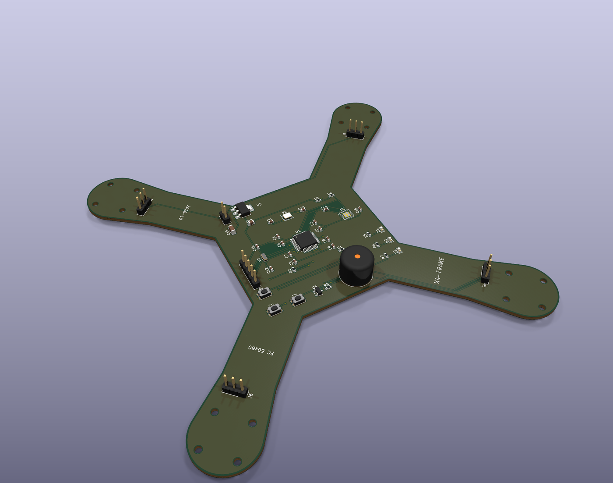

**3D 等轴测**：136.2 × 136.2 mm 双层板，43 个元件集中在中心 60×60 区，四条臂只走电机座与电调焊盘。板号 `X4-FRAME`、日期码 `2026-10-27` 在丝印上。

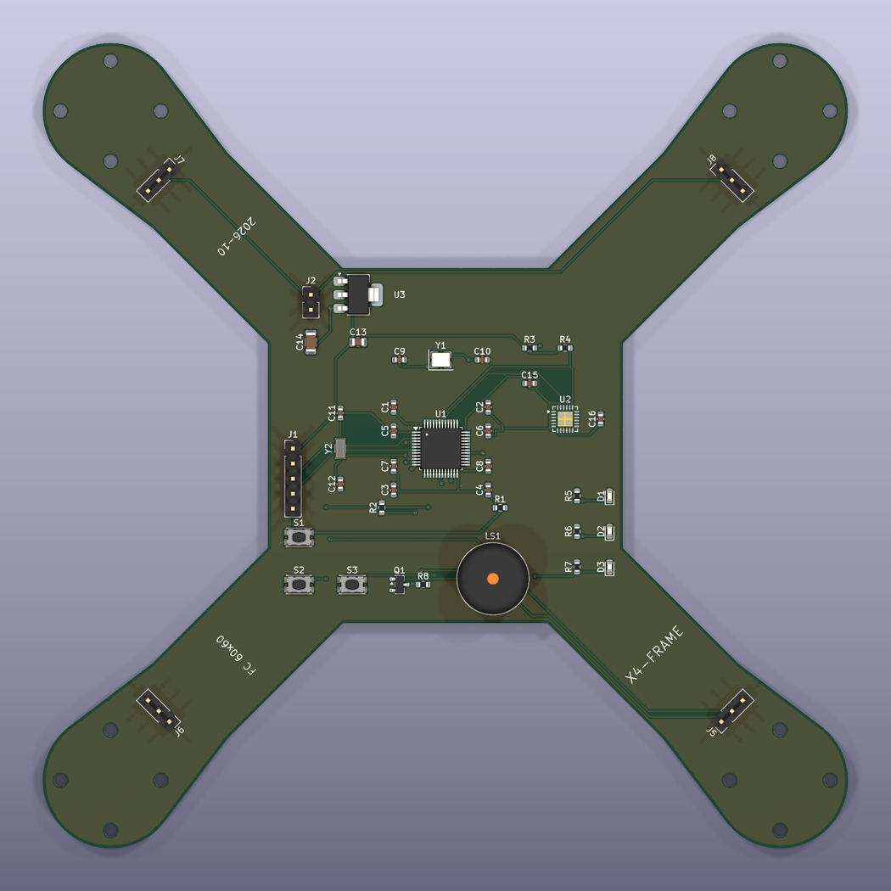

**3D 顶视**：四臂末端 4×M2 电机安装孔，臂端 r11.5 圆形收边，与真实四轴机架安装孔距一致。

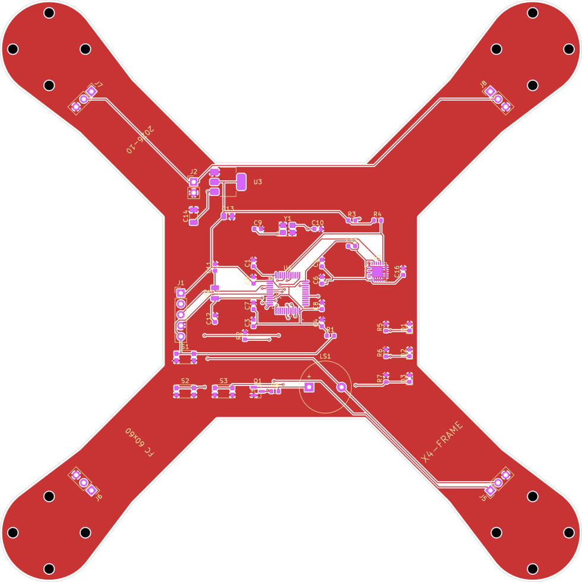

**顶层走线视图**：461 段走线、39 个过孔、总长 1849 mm，双面 GND 铺铜。走线从中心 MCU 扇出到四臂，电源与地走宽铜、信号走 0.15 mm。

### 打样包里有什么

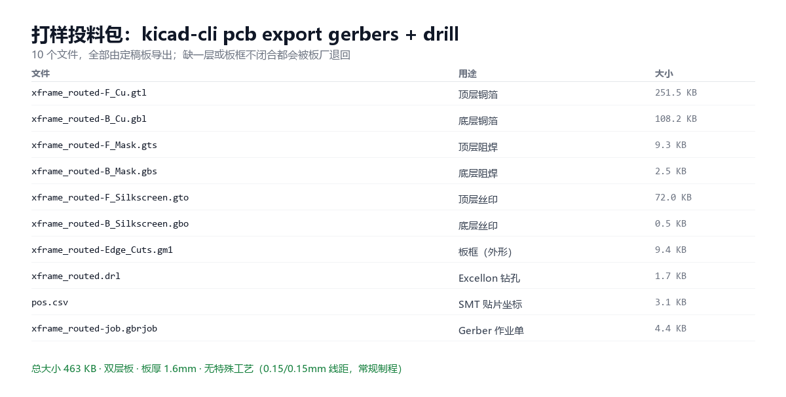

10 个文件：F/B 铜箔、F/B 阻焊、F/B 丝印、板框、Excellon 钻孔、SMT 贴片坐标、Gerber 作业单。**板框闭合、层数完整，可以直接投料**——但下单这一步仍是人工上传（华秋/嘉立创没有公开 API，AI 能到的是「交付一个板厂能读的包」，不是「替人点下单」）。

### 三个遗留问题（自己先说，不等别人问）

1. **没有原理图工程，ERC 跑不了。** 这一版是从 PCB 侧反推重建的，几何 DRC 全绿不等于电气正确。补 `.kicad_sch` 并跑 ERC 是下一步。
2. **MPU6050 的 QFN-24 引脚按数据手册记忆接线**，几何 DRC 查不出「接错脚」这类电气错误，打样前必须逐脚复核。
3. **没有实物，没上过电。** DRC 0/0 只证明「几何与工艺可行」，不证明「这块板焊起来能用」。闭环的最后一环是打样 + 上电实测，还在排队。

---

## 数据来源

本节所有数字均可用同一套工具复跑，不带任何夸大：

| 工具 | 用途 |
|---|---|
| `kicad-cli 10.0.6 pcb drc --format json` | 唯一判分依据（violations / unconnected_items） |
| `kicad-cli pcb export gerbers/drill/pos` | 打样包导出 |
| `kicad-cli pcb render` | 3D 渲染（`--quality high --floor --perspective --zoom 0.76`） |
| `pcbnew` Python API（KiCad 10 绑定） | 板框几何计算、封装放置、SES 回灌、铺铜 ZONE_FILLER |
| FreeRouting 2.4.1（JDK 25） | Specctra DSN → SES 自动布线 |
