# 作品集展示 Portfolio

个人项目作品展示仓库：**源码均存放在私有仓库**（防止被克隆抄用），此处公开展示项目介绍与效果图/设计图。

---

## 一、智法通 · 企业级智能法律顾问平台

> 源码仓库（私有）：`zhifatong`

面向企业的智能法律顾问平台：基于大模型 + RAG 检索增强，提供法律问答、合同智能审查（风险条款识别与分级）、知识库管理、数据分析看板等能力，全流程 FastAPI + Vue3 + MySQL + 向量检索部署。

### 系统截图

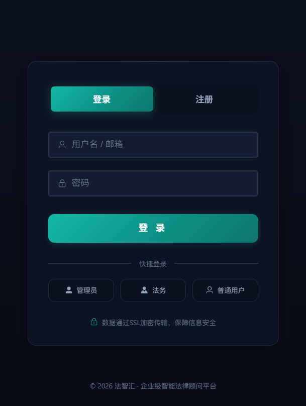
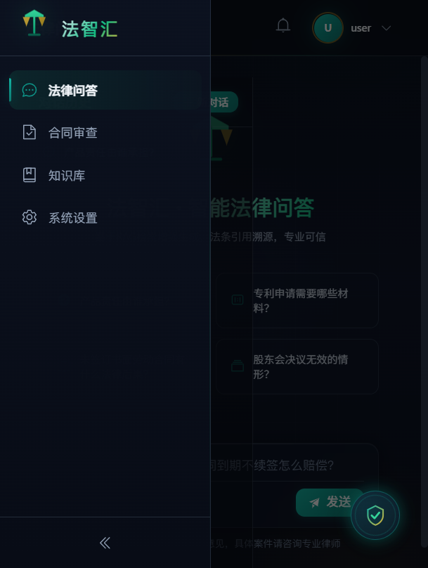
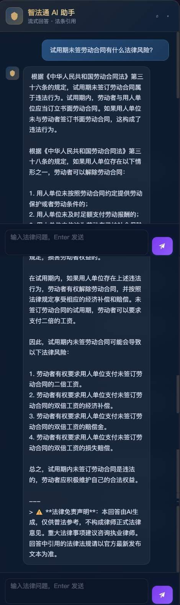
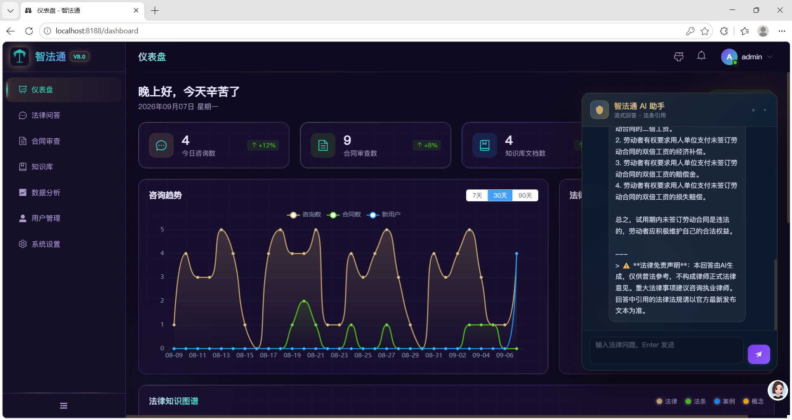
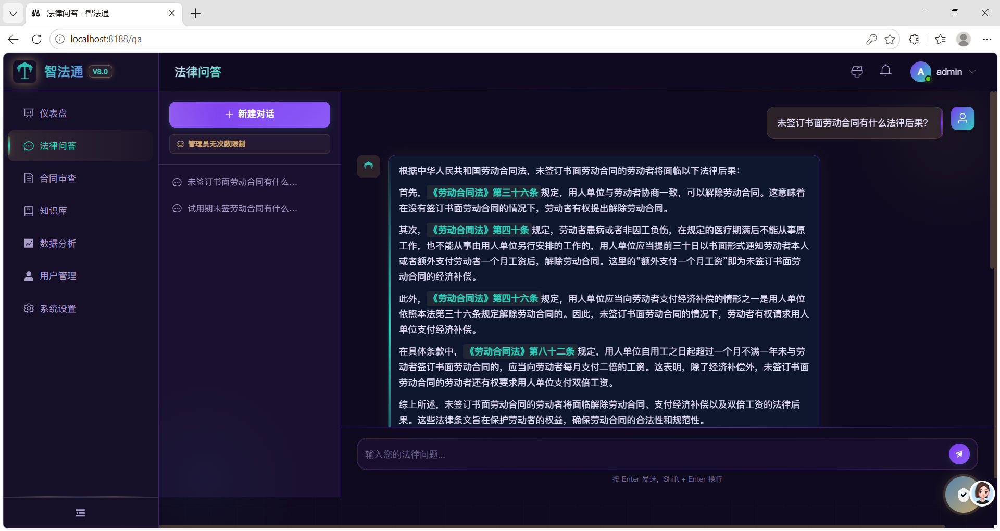
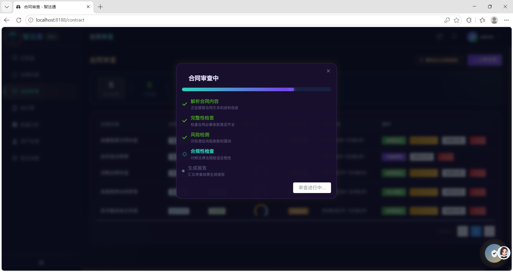
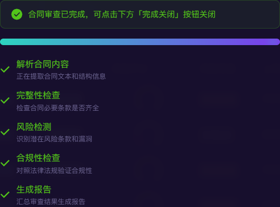
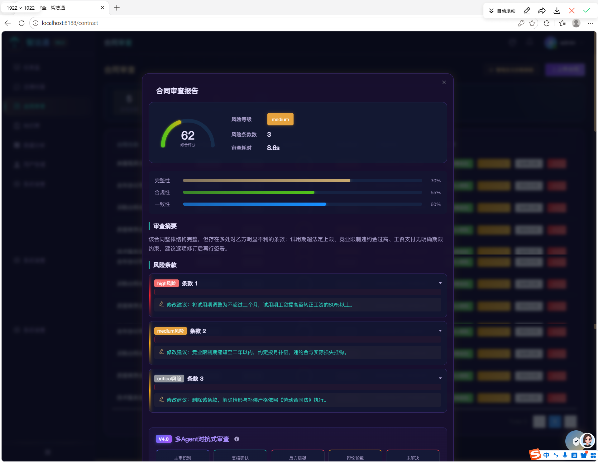
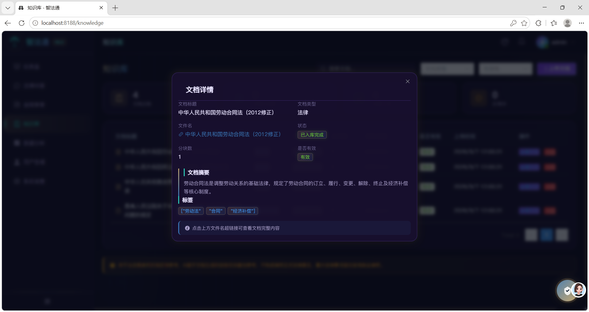
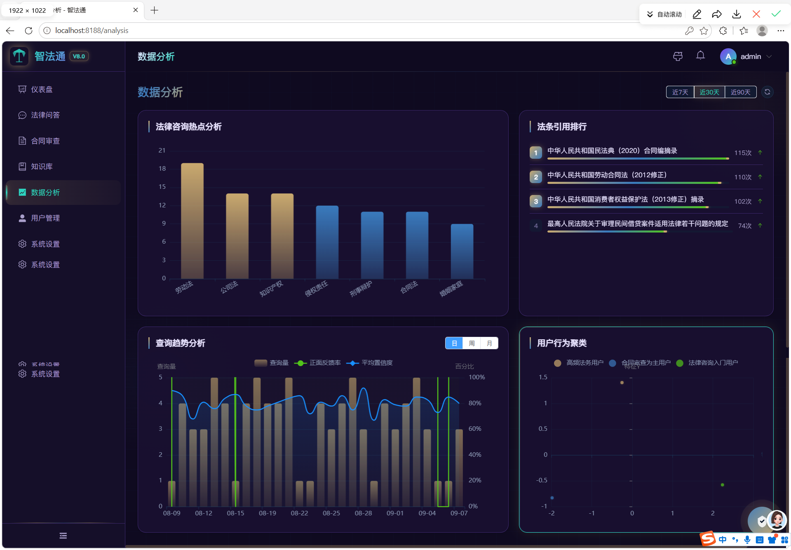
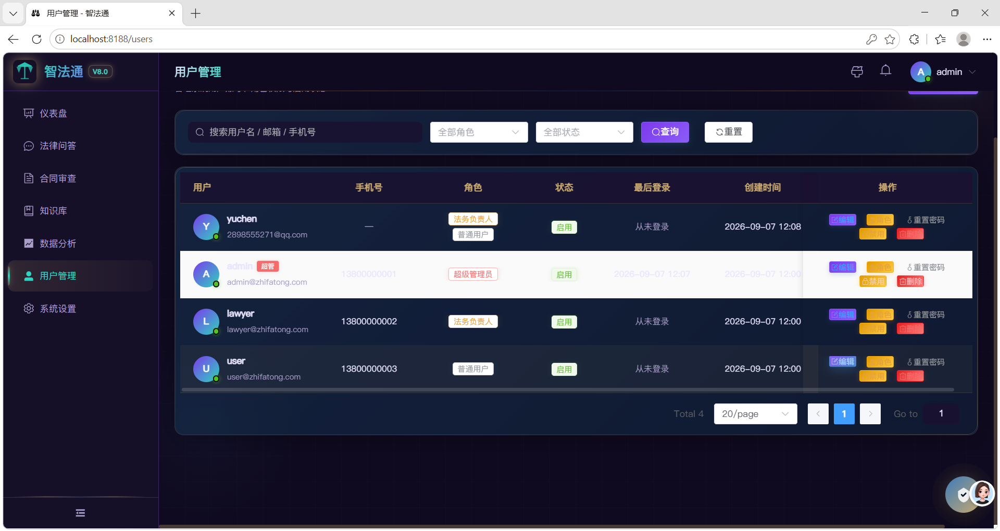

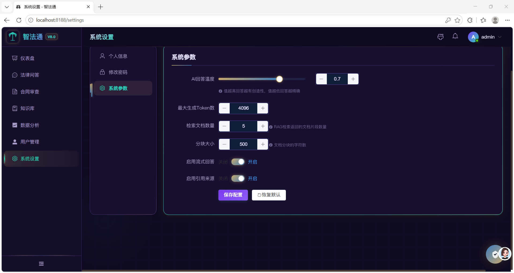

---

## 二、硅流 · AI 辅助硬件设计多智能体平台

> 源码仓库（私有）：`silicon-flow`

AI 辅助硬件设计多智能体平台，覆盖从原理图生成到打板的全流程（多 Agent 流水线编排 + 三级降级保障），图为 STM32-MinSys 最小系统板（KiCad）设计产出。

### 产品图

---

## 三、智融析 · 金融智能研报分析与投资决策辅助系统

> 源码仓库（私有）：`zhirongxi`

（README 补充中……）

---
