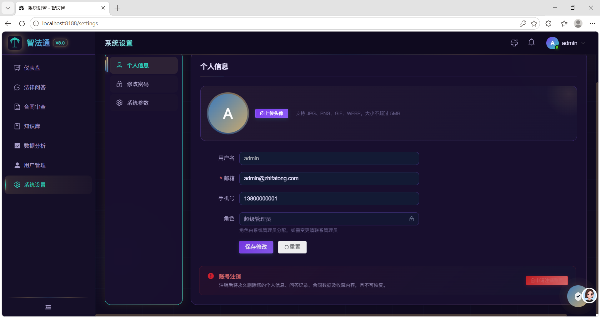

# 作品集展示 Portfolio

个人项目作品展示仓库：**源码均存放在私有仓库**（防止被克隆抄用），此处公开展示项目介绍与效果图/设计图。

---

---

## 一、智融析 · 金融智能研报分析与投资决策辅助系统智融析 · 金融智能研报分析与投资决策辅助系统

> 源码仓库（私有）：`zhirongxi`

面向金融研报场景的 AI 全栈应用系统：研报上传解析、智能问答、一键研报生成与合规审核，覆盖数据采集到报告产出完整闭环。技术栈：FastAPI + React 18 + MySQL + Redis + Neo4j + ChromaDB + LangGraph + Ollama + Docker Compose。

### 系统截图

**01_登录页**：登录页：RAG 智能解读 / ML 量化分析 / 合规自动审核三大能力 + 三角色 RBAC 差异化菜单

**02_知识库管理**：金融文档知识库：批量上传（PDF/Word/HTML/TXT）、自动解析嵌入、重建索引、检索测试

**03_文档解析分块**：财报 PDF 解析为语义分块（bge-large-zh 嵌入，含 tokens 与原文溯源）

**04_关联图谱**：Neo4j 知识图谱：公司-行业-概念关系可视化（归属/关联/同行业）

**05_监控告警与链路追踪**：告警面板（RAG 延迟/LLM 错误率/合规违规）+ LangSmith 全链路 Trace

**06_系统首页仪表盘**：首页：知识库文档/解读查询/分析任务/风险预警 + 使用趋势 + 任务分布

**07_系统监控与架构**：四引擎架构：RAG(LlamaIndex+Chroma)/ML(sklearn+NumPy)/LLM(Qwen2.5+Ollama)/Agent(LangGraph)

**08_评估指标看板**：16 项质量指标：问答准确率 82.3%、幻觉率 0%、来源覆盖 100%、工具调用成功率 85.3%

**09_研报解读问答**：智能问答：核心回答+详细分析+风险提示，置信度自评估并触发补充检索

**10_综合分析ML量化**：ML 量化分析：趋势预测 R²、风险分级、聚类分群 + AI 五维专业解读

**11_研报生成**：LangGraph 四角色流水线自动生成结构化研报（投资要点/公司概况/行业分析/财务分析）

**12_财务分析**：财务与估值：ROE/PE/PB/EPS 解读 + 三表解读 + 估值分析 + 风险提示

**13_风险提示与投资建议**：风险维度拆解（财务/市场）+ 自动评级与目标价（强烈推荐）

---

---

## 二、硅流 · AI 辅助硬件设计多智能体平台硅流 · AI 辅助硬件设计多智能体平台

> 源码仓库（私有）：`silicon-flow`

AI 辅助硬件设计多智能体平台，覆盖从原理图生成到打板的全流程（多 Agent 流水线编排 + 三级降级保障），图为 STM32-MinSys 最小系统板（KiCad）设计产出。

### 产品图

---

---

## 三、智法通 · 企业级智能法律顾问平台智法通 · 企业级智能法律顾问平台

> 源码仓库（私有）：`zhifatong`

面向企业的智能法律顾问平台：基于大模型 + RAG 检索增强，提供法律问答、合同智能审查（风险条款识别与分级）、知识库管理、数据分析看板等能力，全流程 FastAPI + Vue3 + MySQL + 向量检索部署。

### 系统截图

---
